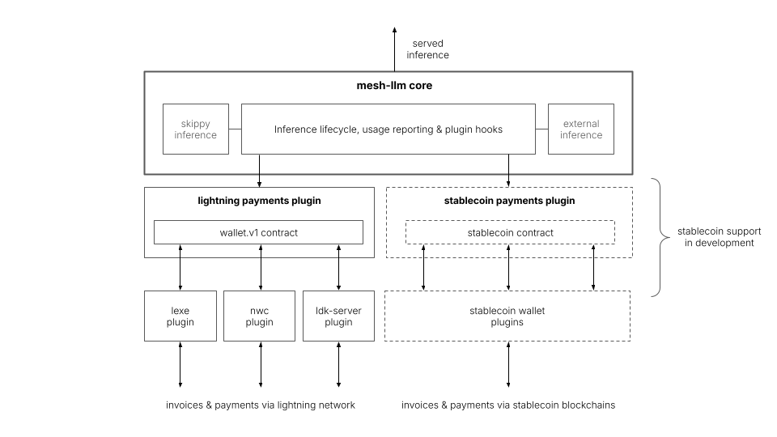

# Earn with micropayments in mesh-llm

Earn money from underutilized compute by serving inference on the mesh. Choose a
model, set your prices, and receive payments when other peers use it.

Mesh handles inference and usage reporting; payments plugins handle billing and
settlement in a decentralized way through separate wallet plugins. Bitcoin Lightning is the first
supported rail. Stablecoin support is in development—coming soon.



<p align="center"><em>mesh payments architecture</em></p>

## 1. Install payments plugins

Install the Lightning payment engine (`pay-lightning`) with one wallet plugin
on each node that buys or serves paid inference.

**Lexe** provisions a mainnet wallet when Mesh starts with a fresh profile.

```sh
mesh-llm plugins install Mesh-LLM/ln-payments-plugin Mesh-LLM/lexe-wallet-plugin
```

Lexe's default recovery seed location is
`<data_dir>/wallets/lexe-wallet/seedphrase.txt`, using `data_dir` from
`payment.json` (default `~/.mesh-llm/payments`). Back up this file securely and
keep it private.

**Nostr Wallet Connect (NWC)** connects to an existing mainnet wallet.

```sh
mesh-llm plugins install Mesh-LLM/ln-payments-plugin Mesh-LLM/nwc-wallet-plugin
```

Before starting Mesh, save the connection URI in a private file and set
`--uri-file` to its absolute path in the `nwc-wallet` plugin entry in
`~/.mesh-llm/config.toml`. See the [NWC configuration example](https://github.com/Mesh-LLM/nwc-wallet-plugin/blob/v0.1.0/README.md#configure).

If Mesh is already running, restart it to load the plugins.

## 2. Serve and earn

For a fresh provider, create `~/.mesh-llm/payments/payment.json` with an absolute
data directory and your model's exact advertised ID. For an existing profile,
preserve its directory and other settings.

```json
{
  "data_dir": "/absolute/path/to/payments",
  "prices": {
    "MODEL_ID": {
      "input_msat_per_million": 10000,
      "output_msat_per_million": 50000,
      "cache_discount_percent": 0
    }
  },
  "policy": {"mode": "free_only"}
}
```

This charges **10 sats per million input tokens** and **50 sats per million output
tokens**. The API's `msat` fields use one-thousandth of 1 sat.

```sh
mesh-llm serve --auto --model 'MODEL_NAME_OR_HUGGING_FACE_REF'
```

Configure prices before startup so the node advertises paid service.
Keep the engine and wallet running. Receiving payments does not require enabling
automatic buying.

## 3. Consume paid inference

On the buyer side, install payments plugins (as described above), then start the mesh client:

```sh
mesh-llm client --auto
```

### Find paid inference

On a running local node, look for `pay.ln.v1` in each model provider's
`requires[].channel` gossip. The same model can have free and paid providers.

```sh
curl -fsS 'http://127.0.0.1:3131/mesh/v1/models?limit=500' |
  jq '.data[] | .id as $model | .providers[]
      | select(any(.requires[]?; .channel == "pay.ln.v1"))
      | {model:$model, node:.provider_id, available}'
```

Prices are negotiated separately; `available` reflects local routing eligibility,
not wallet readiness or permission to spend.

### Fund a wallet and enable spending

Fund your wallet by creating a funding invoice, pay the returned BOLT11 invoice from another
Lightning wallet, then check the balance, e.g. to create a 1,000 sat invoice:

```sh
mesh-llm plugins call pay-lightning control --input '{"command":"fund","amount_msat":1000000}'
mesh-llm plugins call pay-lightning control --input '{"command":"balance"}'
```

Funding does not authorize purchases. Enable automatic purchases with a daily budget, for example 500 sats per day:

```sh
mesh-llm plugins call pay-lightning control --input '{"command":"policy","value":{"mode":"automatic","daily_budget_msat":500000}}'
```

Update the `policy` section in your existing `payment.json` so the change
survives restart.

Use `free_only` to return to free inference:

```sh
mesh-llm plugins call pay-lightning control --input '{"command":"policy","value":{"mode":"free_only"}}'
```

`free_only` stops new paid purchases; already-admitted work can still settle.

Check settled payments with:

```sh
mesh-llm plugins call pay-lightning control --input '{"command":"transactions","limit":20}'
```

Controls use management port `3131`; add `--port PORT` if yours differs.

## How payments work

Peers agree on prices, and an initial admission payment counts toward the first
bill. Any unused portion of that initial deposit is not refunded.
Warm clients in good standing skip that payment. Backend-reported usage
determines the final bill, with any remainder invoiced asynchronously. Three
unpaid final invoices cause the provider to refuse further paid inference.

Initial admission payment and minimum payments are configurable as follows:

```sh
mesh-llm plugins call pay-lightning control --input '{"command":"min_payment","value_msat":1000}'
mesh-llm plugins call pay-lightning control --input '{"command":"admission_deposit","value_msat":5000}'
```

Payments remain experimental.
Buyers trust provider usage reports; [inference auditing and model verification](https://github.com/Mesh-LLM/mesh-llm/pull/2981)
are in development.
Revenue sharing across split-model workers is not yet supported.

See the [Lightning engine guide](https://github.com/Mesh-LLM/ln-payments-plugin)
for protocol and operator details.
