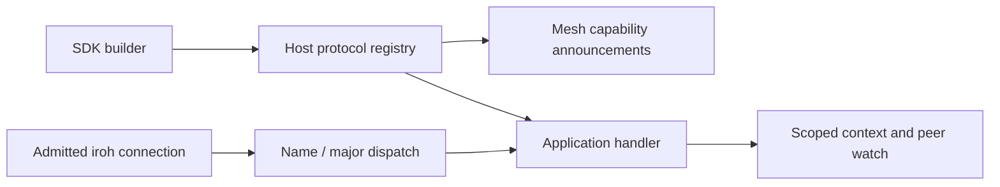
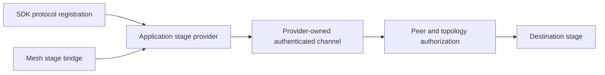

# mesh-llm-sdk

Rust facade for the real embedded Mesh LLM node. `MeshNode::builder()` supports
client (`client()`), serve-only (`serve_only()`), and combined (`serve()`) roles.
The legacy thin client re-export is removed. The default feature is `serving`,
which includes the embedded runtime and native runtime management APIs.

See [Rust SDK usage](../../docs/sdk/rust.md) and
[native runtime guidance](../../docs/SDK.md#native-runtime-artifacts).

## Install the serving runtime

Client-only nodes need no native serving runtime. Before starting a serve-only
or combined node, check the cached runtime with
`native_runtime_versions_match_current_sdk`, then explicitly install a
compatible runtime when needed:

```rust,no_run
use mesh_llm_sdk::native_runtime::{
    NativeRuntimeInstallOptions, RuntimeSelection, current_runtime_release,
    current_skippy_abi_version, install_native_runtime,
    mesh_native_runtime_install_options, native_runtime_versions_match_current_sdk,
};
use mesh_llm_sdk::{MeshNode, initialize_host_runtime};

#[tokio::main]
async fn main() -> anyhow::Result<()> {
    let outcome = install_native_runtime(NativeRuntimeInstallOptions {
        release_version: current_runtime_release().to_string(),
        skippy_abi_version: Some(current_skippy_abi_version()),
        selection: RuntimeSelection::Recommended,
        ..mesh_native_runtime_install_options()
    }).await?;
    let runtime = outcome.runtime;
    anyhow::ensure!(native_runtime_versions_match_current_sdk(
        &runtime.mesh_version,
        &runtime.manifest.runtime.skippy_abi,
    ));
    runtime.load_plan()?;
    initialize_host_runtime().await?;
    let node = MeshNode::builder().serve().start().await?;
    node.shutdown().await?;
    Ok(())
}
```

The installer resolves the
recommended runtime against the current host profile and returns a compatible
cached runtime when available. The load plan verifies its libraries before
startup. Embedded node startup only loads a compatible cached
runtime; it never downloads one. Install before starting a serving node when
the cache has no matching runtime.

## Application protocols

Register handlers before startup with `MeshNode::builder().protocol(Arc::new(handler))`.
The SDK advertises the descriptor through the existing mesh subprotocol envelope, and routes
streams by name and major version. Old nodes ignore unknown descriptors and reject unsupported
streams. There are no new ALPNs or changes to the built-in stage protocol. A relay that predates
this change strips application descriptors when rebroadcasting; an admitted peer's capability set
is learned from its direct announcements and survives such rebroadcasts. If a gossip frame nears
the control-frame size ceiling, the node prunes application descriptors from relayed entries —
never its own — instead of failing the whole gossip exchange.

```rust,no_run
use std::sync::Arc;
use mesh_llm_sdk::{MeshNode, protocol::{async_trait, IncomingProtocolStream,
    MeshProtocol, ProtocolContext, ProtocolDescriptor}};
use tokio::io::{AsyncReadExt, AsyncWriteExt};

#[derive(Debug)]
struct Echo;

#[async_trait]
impl MeshProtocol for Echo {
    fn descriptor(&self) -> ProtocolDescriptor {
        ProtocolDescriptor::new("echo", 1)
    }

    async fn accept(&self, _: ProtocolContext, mut incoming: IncomingProtocolStream)
        -> anyhow::Result<()> {
        let value = incoming.stream.read_u32().await?;
        incoming.stream.write_u32(value).await?;
        incoming.stream.shutdown().await?;
        Ok(())
    }
}

async fn start() -> anyhow::Result<()> {
    let node = MeshNode::builder().client().protocol(Arc::new(Echo)).start().await?;
    node.shutdown().await?;
    Ok(())
}
```

Override `run(context)` for background work on the embedded runtime. `context.watch_peers()`
provides an initial snapshot and updates of admitted peers; filter with `peer.supports()`.
`context.open(peer.id)` opens this handler's protocol, with a ten-second dial deadline, only to
admitted peers advertising the same name and major version. Incoming identity comes from the
authenticated connection in `incoming.peer`. Capabilities are hints, not proof of application
readiness. Handlers own framing, payload bounds and transaction timeouts.

Registration accepts at most 16 protocols, rejects duplicate name/major pairs and reserves
the built-in protocol names (`BUILT_IN_PROTOCOL_NAMES`, currently `skippy-stage`). Names use
lowercase ASCII letters, digits, dots and hyphens (1–64 bytes), major
versions are positive, and features are at most 32 strings of 1–64 ASCII letters, digits, dots,
hyphens or underscores. Keep `descriptor()` stable for the lifetime of the handler.

The runtime allows at most 32 concurrent incoming application streams; once the cap is reached,
additional incoming opens are rejected rather than queued. It cancels incoming
handlers when the node stops and signals `context.cancelled()` to background work, allowing one
second for cleanup before aborting remaining tasks. Await work inside `run`/`accept`; detached
tasks created by a handler are the application's responsibility. Registrations cannot change
after startup.



### Application stage transport

A registered `MeshProtocol` can return a `StageTransportProvider` from its
`stage_transport()` method. Its `open_stage(context, peer)` returns an owned
`ProtocolStream`, or `None` to use the existing dedicated Iroh stage connection.
The protocol's inbound handler calls `context.accept_stage(incoming.peer, stream)`
using the identity established by its authenticated setup. Mesh then checks the
stage header, topology, run, destination readiness and admission before bridging
the channel to the local stage. Admission loss and shutdown cancel the channel.

```rust,ignore
#[async_trait]
impl StageTransportProvider for MyProtocol {
    async fn open_stage(&self, context: ProtocolContext, peer: PeerId)
        -> anyhow::Result<Option<ProtocolStream>> {
        self.connect_stage_channel(context, peer).await
    }
}
// In MeshProtocol's implementation:
// fn stage_transport(&self) -> Option<&dyn StageTransportProvider> { Some(self) }
// In its authenticated inbound channel handler:
// context.accept_stage(incoming.peer, connected_stream).await?;
```

At most one stage provider may be registered. Protocols with a stage provider admit inbound
streams from a dedicated 32-permit pool, so long-lived stage channels cannot exhaust the shared
application-stream pool (and excess stage opens are rejected rather than queued, like the shared
pool). The provider must supply reliable, ordered
bytes, support half-close, and release its owned work when the stream is dropped. Errors fail the connection; Mesh never
replays stage bytes over another transport. Stage control, artifacts and activation
encoding retain their existing contracts. See the
[application stage transport contract](../../docs/specs/APPLICATION_STAGE_TRANSPORT.md).


