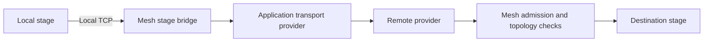

# Application stage transports

An SDK application protocol can implement `StageTransportProvider` and return it
from `MeshProtocol::stage_transport`. At most one provider may be registered per
node. The existing `.protocol(handler)` registration owns its lifetime.

Mesh calls `open_stage(context, peer)` only for admitted peers advertising the same
application protocol. `Ok(None)` declines before stage bytes have been sent and
preserves the existing dedicated Iroh transport. `Err` fails opening; Mesh never
replays stage bytes over a different transport. `Ok(Some(stream))` supplies a
reliable, ordered duplex byte stream with
half-close semantics. The application binds this channel to the authenticated setup
peer. Mesh writes the existing `StageTransportOpen` followed by unchanged stage bytes.

Inbound providers call `context.accept_stage(peer, stream)` with the peer identity
from authenticated setup. Mesh checks admission, requester identity, topology, run,
destination stage and local readiness before opening the local stage socket. The
header has a ten-second deadline. Admission loss or node shutdown terminates the
channel; providers must also cancel outstanding setup and native work on stream drop.
Providers must not interpret remote stage addresses as local TCP destinations.
Protocols with a stage provider admit their inbound streams from a dedicated
32-permit pool so long-lived stage channels cannot starve the shared
application-stream pool; excess stage opens are rejected, not queued.

The application protocol is the setup/control channel. It does not replace built-in
stage control or artifact transfer. No stage encoding or dedicated Iroh wire changes
are required, and nodes without a provider continue using the existing path.
