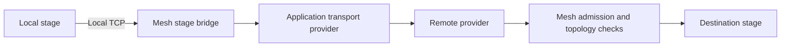

# Application stage transports

An SDK application protocol can implement `StageTransportProvider` and return it
from `MeshProtocol::stage_transport`. At most one provider may be registered per
node. The existing `.protocol(handler)` registration owns its lifetime.

Mesh calls `open_stage(context, peer)` only for admitted peers advertising the same
application protocol. `Ok(None)` declines before stage bytes have been sent and
preserves the existing dedicated Iroh transport. `Err` fails opening; Mesh never
replays stage bytes over a different transport. `Ok(Some(stream))` supplies a
reliable, ordered duplex byte stream with
half-close semantics. The application binds this channel to the authenticated setup
peer. Mesh writes the existing `StageTransportOpen` followed by unchanged stage bytes.

Inbound providers call `context.accept_stage(peer, stream)` with the peer identity
from authenticated setup. Mesh checks admission, requester identity, topology, run,
destination stage and local readiness before opening the local stage socket. The
header has a ten-second deadline. Admission loss or node shutdown terminates the
channel; providers must also cancel outstanding setup and native work on stream drop.
Providers must not interpret remote stage addresses as local TCP destinations.

The application protocol is the setup/control channel. It does not replace built-in
stage control or artifact transfer. No stage encoding or dedicated Iroh wire changes
are required, and nodes without a provider continue using the existing path.

## Local link observations

`StageTransportProvider::stage_link(peer)` optionally reports outgoing delivery
observations for an active channel. `StageLinkObservation` preserves `Duration`
precision and separates acknowledgement latency from acknowledged payload goodput.
Goodput includes polling, framing, acknowledgements and receiver backpressure; it
is not a raw link speed. Samples exclude idle application time and local enqueue
time. Providers invalidate observations when the stream fails, closes or becomes
unusable, and return `None` when a new connection would decline to the default path.

The host consumes observations only for currently admitted, protocol-compatible
peers, with at least three samples and an age below thirty seconds. It supplies
directed coordinator-to-peer latency edges to the pure topology planner. Missing
edges retain the existing RTT estimate, clamped to at least one millisecond when
comparing measured paths because legacy RTTs truncate sub-millisecond values.
Candidate comparisons retain nanosecond
precision; the existing millisecond diagnostic rounds up. Without observations,
planning is unchanged. Goodput is exposed for diagnostics and future payload-aware
costing; it is not charged against a guessed activation size.

These are in-process SDK values. Nothing is added to gossip, setup frames or stage
messages. Remote-to-remote observations are not inferred or propagated. Cold start
uses existing RTTs until live traffic supplies enough samples; this does not
introduce probe traffic or force replanning an active topology.
