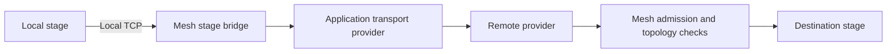

# Application stage transports

## Required provider policy

SDK builders accept `.stage_transport_policy(StageTransportPolicy::RequireProvider)`.
The default `PreferProvider` preserves fallback. Required mode needs a registered
stage provider and fails configuration validation before starting the runtime if
one is absent. The host adds the reserved `stage-provider-required` feature to that
provider's existing capability descriptor; applications must not set it themselves.
All participants must opt in to provide a whole-split requirement. Peers with no
matching required-provider capability are excluded from planning.

`StageTransportProvider::stage_available(peer)` supplies a nonblocking cached
readiness hint for planning. Its default permits an attempt; implementations may
exclude known unavailable paths without requiring performance samples. Before
planning excludes a peer for exhausted capacity, the provider must account for
usable existing channels so a healthy split is not withdrawn just for using its
connection budget. Before
creating a remote stage bridge, required mode opens and drops a provider stream
to verify setup. This sends no stage bytes and reserves no long-lived capacity.
Each node performs this check for its own stage neighbors during load, including
the last stage's return connection. Setup errors prevent that load from becoming
ready; opening an actual activation connection repeats setup and can still fail.

Missing support, unavailable paths, provider declines and setup failures never
fall back in required mode. Direct outbound and inbound dedicated Iroh activation
streams are also rejected. Discovery, authenticated setup, stage control and
artifact traffic retain their existing paths. The policy remains local SDK state;
only the existing capability feature list changes, without wire-format or protocol
version changes. Unsupported or preferred-provider nodes remain interoperable for
ordinary mesh operations but cannot participate in a required-provider split.

An SDK application protocol can implement `StageTransportProvider` and return it
from `MeshProtocol::stage_transport`. At most one provider may be registered per
node. The existing `.protocol(handler)` registration owns its lifetime.

Mesh calls `open_stage(context, peer)` only for admitted peers advertising the same
application protocol. `Ok(None)` declines before stage bytes have been sent and
preserves the existing dedicated Iroh transport. `Err` fails opening; Mesh never
replays stage bytes over a different transport. `Ok(Some(stream))` supplies a
reliable, ordered duplex byte stream with
half-close semantics. The application binds this channel to the authenticated setup
peer. Mesh writes the existing `StageTransportOpen` followed by unchanged stage bytes.

Inbound providers call `context.accept_stage(peer, stream)` with the peer identity
from authenticated setup. Mesh checks admission, requester identity, topology, run,
destination stage and local readiness before opening the local stage socket. The
header has a ten-second deadline. Admission loss or node shutdown terminates the
channel; providers must also cancel outstanding setup and native work on stream drop.
Providers must not interpret remote stage addresses as local TCP destinations.

The application protocol is the setup/control channel. It does not replace built-in
stage control or artifact transfer. No stage encoding or dedicated Iroh wire changes
are required, and nodes without a provider continue using the existing path.

## Local link observations

`StageTransportProvider::stage_link(peer)` optionally reports outgoing delivery
observations for an active channel. `StageLinkObservation` preserves `Duration`
precision and separates acknowledgement latency from acknowledged payload goodput.
Goodput includes polling, framing, acknowledgements and receiver backpressure; it
is not a raw link speed. Samples exclude idle application time and local enqueue
time. Providers invalidate observations when the stream fails, closes or becomes
unusable, and return `None` when a new connection would decline to the default path.

The host consumes observations only for currently admitted, protocol-compatible
peers, with at least three samples and an age below thirty seconds. It supplies
directed coordinator-to-peer latency edges to the pure topology planner. Missing
edges retain the existing RTT estimate, clamped to at least one millisecond when
comparing measured paths because legacy RTTs truncate sub-millisecond values.
Candidate comparisons retain nanosecond
precision; the existing millisecond diagnostic rounds up. Without observations,
planning is unchanged. Goodput is exposed for diagnostics and future payload-aware
costing; it is not charged against a guessed activation size.

These are in-process SDK values. Nothing is added to gossip, setup frames or stage
messages. Remote-to-remote observations are not inferred or propagated. Cold start
uses existing RTTs until live traffic supplies enough samples; this does not
introduce probe traffic or force replanning an active topology.
