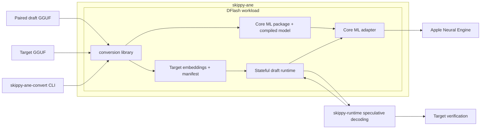

# skippy-ane

`skippy-ane` owns Skippy's integration with Apple Neural Engine through Core ML.
Its first workload is the paired Qwen3.6 DFlash drafter. The crate owns the
workload's model conversion, Core ML execution, and hardware placement check.
`skippy-runtime` owns speculative decoding, target execution, and verification.
This crate has no dependency on MeshLLM or Skippy runtime crates.



The `dflash` module keeps its converter and runtime together because they share
a fixed model shape and package contract. `dflash::conversion` is available as
a Rust library and through `skippy-ane-convert`; `dflash::AneDraft` is the macOS
runtime entry point. Its `coreml` module contains the DFlash graph's Core ML
inputs, outputs, and state handling. A future ANE workload can have a peer
module with its own package and runtime contract. Shared Core ML code belongs
at the crate level only when more than one workload uses it.

Convert from the workspace root with `just dflash-ane-convert`. The executable
is `skippy-ane-convert`; it accepts `--draft`, `--target`, `--out`,
`--embeddings-out`, `--context`, and `--rows`. Rust callers can use the same
conversion without a child process:

```rust,no_run
use skippy_ane::dflash::conversion::{ConversionOptions, convert};

let options = ConversionOptions {
    draft: "draft.gguf".into(),
    target: "target.gguf".into(),
    out: "draft.mlpackage".into(),
    embeddings_out: "embeddings.f16".into(),
    context: 512,
    rows: 7,
};
convert(&options)?;
# Ok::<(), anyhow::Error>(())
```

The `conversion` feature is enabled by default. `skippy-runtime` disables it
so serving does not compile the GGUF reader or MIL package writer.

See [the ANE guide](../../evals/dflash_ane/README.md) for package requirements
and runtime selection.
