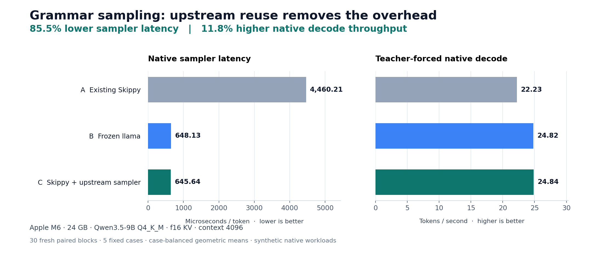
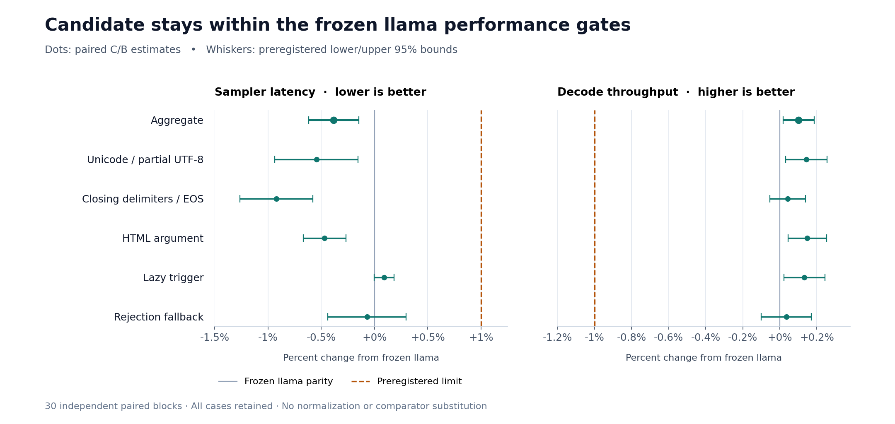

# Qualified M6 sampler results

These figures summarize the completed 30-block qualification for measured source
`a9b37b71bb9ebcff51e321e7fcedba323f7d9458`, against frozen baseline
`3947de0cbc73fe5cbcaae548b297f03a401532d7`. Later figure-only commits do not
change the measured implementation.

The machine was an Apple M6 with 24 GB RAM. The model was Qwen3.5-9B Q4_K_M,
with f16 key/value caches and context 4096. A is existing Skippy, B is frozen
llama, and C is the upstream sampler through the public Skippy ABI.

The absolute bars use case-balanced geometric means. The second figure plots
paired C/B estimates and the preregistered lower/upper 95% bootstrap bounds over
30 independent blocks. The sampler upper bound must be at most +1%; the decode
lower bound must be at least -1%, for every case and the aggregate. The separate
aggregate improvement gates against A also passed. Aggregate gains do not imply
an improvement against A in every individual case.

Each arm used three complete warmup blocks before its measured block, with
fresh independent workers and predetermined balanced order. All 900 measured
and 2700 warmup observations were retained. No normalization, exclusions,
comparator substitution, or gate relaxation was used. See the
[frozen plan](../plan.json) and [evaluator documentation](../README.md).

[qualified-m6.json](qualified-m6.json) contains the plotted data, source/audit
hashes, and JY execution identities. The complete qualification audit and raw
observations are recorded in shared MLflow experiment 18, parent run
`c6be7f6e7fbf4e6c8bbf28e8bb77dd03`. These results cover five synthetic grammar
cases, native sampling, and teacher-forced native decode. They do not establish
end-to-end performance, 35B performance, or draft-head quality.
